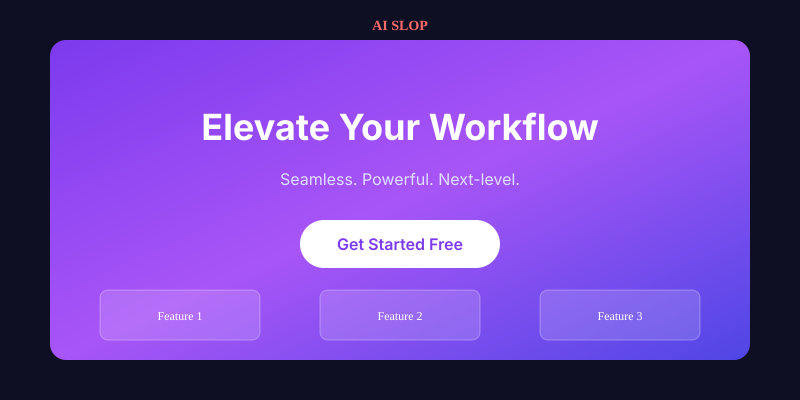
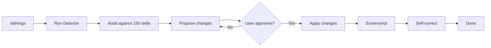

# AI Things

**Stop shipping purple gradients.**

A production-ready design skill for coding agents that detects and fixes AI slop in web design.

[](LICENSE)
[](#structure)
[](detect-slop.js)

---

## The Problem

AI coding agents produce the same design every time.

<div align="center">
  
  <p><em>The average AI-generated page: purple gradient, centered everything, three identical cards, generic copy.</em></p>
</div>

**Common tells:**
- Purple / indigo → blue gradients
- Inter / Roboto / Geist everywhere
- Three feature cards with Lucide icons
- Eyebrow labels and pill badges
- Glassmorphism + soft shadows
- “Seamless. Powerful. Next-level.”

None of these are evil alone. Together they scream “nobody decided anything.”

---

## The Solution

AI Things gives agents 150 specific, intentional design skills and a workflow that forces decisions.

<div align="center">
  
  <p><em>Same product, different result: specific headline, real hierarchy, brand color, constrained type.</em></p>
</div>

### How it works



1. **Detect** — `node detect-slop.js` scans your code
2. **Propose** — Agent lists specific fixes with reasoning
3. **Approve** — You say yes
4. **Apply** — Changes are made
5. **Screenshot & fix** — Agent looks at the result and iterates

---

## Quick Start

### As a Skill (Claude Code, Codex, Cursor…)

```bash
# Tell your agent:
# "Read and follow SKILL.md from https://github.com/withermen/Ai-dizayn-things"
# or simply type:
/aithings
```

### As a Detector

```bash
git clone https://github.com/withermen/Ai-dizayn-things
cd Ai-dizayn-things
node detect-slop.js .
node detect-slop.js . --json
```

### MCP

See [MCP.md](MCP.md) for configuration.

---

## What You Get

| Category | Skills | Examples |
|----------|--------|----------|
| **Color & Atmosphere** | 25 | No purple gradients, proper contrast, intentional accents |
| **Typography** | 25 | No Inter-only, real hierarchy, readable line length |
| **Layout** | 25 | No 3-card grids, breathing room, clear visual weight |
| **Components** | 25 | No glassmorphism defaults, real empty states |
| **Motion** | 25 | Respect reduced-motion, purposeful animation only |
| **Copy** | 25 | Specific headlines, no buzzwords, real proof |

**Total: 150 actionable skills**, each with “When it’s OK”, “Why it’s slop”, and “How to fix”.

---

## Detector Output Example

```text
🔍 AI Things — Slop Detector Report

Scanned 42 files. Found 7 potential issues.

CRITICAL (2)
────────────────────────────────────────
• [Color] Purple / Indigo → Blue Gradient
  File: src/Hero.tsx (3 matches)
  Classic AI slop gradient (violet/purple/indigo).

HIGH (3)
────────────────────────────────────────
• [Layout] Three Identical Feature Cards
  File: src/Features.tsx (1 match)
  Classic 3-column feature grid.
```

---

## Philosophy

- **Intentional over average.** Every choice should be traceable to the product or user.
- **Describe → Approve → Apply → Screenshot → Self-correct.**
- Restraint, hierarchy, and real content beat decorative defaults.
- Accessibility is non-negotiable.

---

## Structure

```
├── SKILL.md              # Main agent instructions
├── skills/
│   ├── 01-color.md       # 25 skills
│   ├── 02-typography.md  # 25 skills
│   ├── 03-layout.md      # 25 skills
│   ├── 04-components.md  # 25 skills
│   ├── 05-motion.md      # 25 skills
│   └── 06-copy.md        # 25 skills
├── detect-slop.js        # Node.js automatic scanner
├── package.json
├── MCP.md                # MCP / skill setup
├── docs/images/          # Visual examples
├── LICENSE               # Apache 2.0
└── README.md
```

---

## License

Apache License 2.0. See [LICENSE](LICENSE).

---

<div align="center">
  <strong>Made for agents that refuse to ship purple gradients.</strong>
</div>
